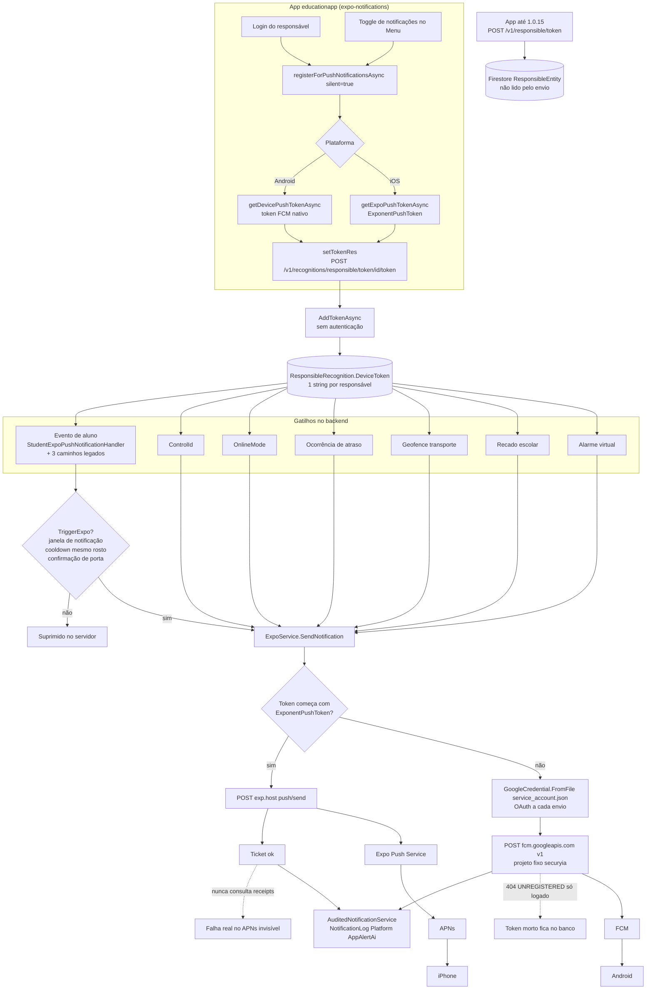

# Notificações push: análise do fluxo e plano de correção

Data da análise: 2026-10-02. Revisado em 2026-10-05 (achados 17 a 24) e revalidado em 2026-10-07 (achados 25 e 26, seção 2.1).
Código lido na revalidação: `alertaiapi2` em `origin/main` (até 2026-10-06) e `educationapp` em `origin/MR-87` (commit `3648a67`, 2026-10-07, app 1.0.81). O checkout local do app estava em `b91e2e1` (1.0.78), 8 commits atrás do remoto; a `main` do app está parada em 1.0.14.
Importante: o que a seção 2.1 chama de "resolvido no app" está em `origin/MR-87` e **só vale para clientes depois que a versão 1.0.81 (ou posterior) for publicada nas lojas e instalada**.
Escopo: `educationapp` (app mobile), `alertaiapi2` (API), envio via Expo e FCM.
Origem: reclamações de clientes que não recebem push (Android e iPhone) e avaliação prévia do Guilherme (front e mobile).

Status: **análise por leitura de código. Nada foi executado em produção nem medido em banco.** Itens marcados como hipótese precisam de verificação.

## 1. Fluxo atual

Diferença estrutural entre plataformas:

| | Android | iOS |
|---|---|---|
| Token | FCM nativo | Expo Push Token |
| Caminho | API -> FCM v1 -> aparelho | API -> Expo -> APNs -> aparelho |
| Credencial | `service_account.json` em cada servidor | credencial APNs no EAS |
| Visibilidade de falha | resposta HTTP do FCM (logada) | só nos receipts do Expo (não consultados) |

## 2. Achados

Severidade: **A** alto, **M** médio, **B** baixo.

| # | Sev | Achado | Evidência | Plataforma |
|---|---|---|---|---|
| 1 | A | Ticket "ok" do Expo não prova entrega. Backend nunca chama `PushGetReceiptsAsync`. NotificationLog mostra sucesso mesmo sem entrega. | `ExpoService.cs:93` | iOS |
| 2 | A | Token morto nunca é limpo. `UNREGISTERED` (FCM) e `DeviceNotRegistered` (Expo) só viram log. | nenhum código zera `DeviceToken` em falha | ambas |
| 3 | A | Token não renova. App só registra no login e no toggle, sem `addPushTokenListener`. Sessão persiste por JWT, então token rotacionado fica velho. **Resolvido no app (MR-87):** `addPushTokenListener` e sync ao abrir com sessão retomada. Falta o backend limpar o antigo. | `NotificationService/index.ts`, `AuthService/index.ts:47` | ambas |
| 4 | A | Um token por responsável. Último aparelho vence. Logout não limpa. Dois responsáveis no mesmo celular compartilham token e o alerta de um chega no outro. **Parcial (MR-87):** logout agora invalida o token no FCM/APNs e o login reenvia o novo. Cria o risco do #25. | `ResponsibleRecognitionEntity.DeviceToken` é `string?` | ambas |
| 5 | A | Edição pelo front sobrescreve o token. Race: admin abre form, usuário loga em outro aparelho, admin salva e o token antigo volta. Default `''` ou campo ausente zera. | `ResponsibleRecognitionService.cs:846, 1301, 2546` (em `origin/main`); `ResponsibleRecognitionEditForm.tsx:74`; o `dto.Adapt` sobrescreve e a linha `:1413` é no-op | ambas |
| 6 | A | `AddToken` sem `[AuthorizeCustom]`. `JwtAuthFilter` global só lê claims, não bloqueia. Qualquer pessoa troca o token de qualquer responsável pelo id e recebe o cadastro de volta (nome, CPF, telefone, e-mail, imagem, `Password`). Ver também o #23: mesmo com o atributo, a validação é fraca. Revalidado em `origin/main` (2026-10-06): continua sem autorização. | `ResponsibleRecognitionController.cs:329`; `JwtAuthFilter.cs` | ambas |
| 7 | A | `ExpoController` sem autorização: `send-notification`, `push-tickets`, `push-receipts`. Relay anônimo de push pelo projeto Firebase. | `ExpoController.cs` | n/a |
| 8 | M | Payload FCM sem `channel_id`. App cria canal `default` (MAX) mas o payload não o usa. Doc do Expo confirma que sem canal especificado o `expo-notifications` cria o fallback "Miscellaneous". Plugin `expo-notifications` ausente no `app.json` (sem `defaultChannel`, ícone). **Mitigado (MR-87):** plugin `expo-notifications` com `defaultChannel: default` entrou no `app.json`, então o canal padrão do FCM passa a ser o `default`. Só vale para builds novos. | `CreateFcmPayload`; `app.json` | Android. Comportamento documentado, **efeito (sem heads-up) a verificar no aparelho** |
| 9 | M | `POST_NOTIFICATIONS` não consta em `android.permissions`. Se faltar no manifest final, request falha em silêncio no Android 13+ (login usa `silent=true`) e o app fica sem token. Não dá para confirmar pelo repo: não há `AndroidManifest.xml` (a pasta `android/` só tem `build/generated`) nem `node_modules`. | `app.json` | Android 13+. **Hipótese, verificar no APK/prebuild** |
| 10 | M | `service_account.json` com caminho relativo e `FcmProjectId` fixo. **Atualização:** em `origin/main` a credencial passou a ser `Lazy` singleton (commit `990f847d`, 2026-10-02), então não relê o arquivo nem pede OAuth novo a cada envio. O `Lazy` cacheia exceção: se o arquivo faltar na primeira chamada, o Android fica falhando até reiniciar a API. O arquivo está versionado em `alertaiapi2/SecuryIa/service_account.json`, então "cliente sem o arquivo" é menos provável se o deploy sai do repo. O risco passa a ser chave revogada, rotacionada ou desatualizada em algum cliente: todo Android falha, iOS segue. Rajada pode estourar o timeout de 10s do `AuditedNotificationService`. | `ExpoService.cs:12-14, 202` | Android, por cliente |
| 11 | M | Supressão legítima no servidor: janela de notificação, cooldown `NotificationTimeSameFace`, confirmação de porta, `IsSendNotification` do aluno. Gera "não recebi" que não é bug de entrega. | `FaceRecognitionEventService.cs:2472` | ambas |
| 12 | M | Toggle do Menu é só local. Desligar remove do AsyncStorage e o backend continua enviando. **Mudou (MR-87):** desligar agora grava opt-out local e invalida o token no FCM/APNs. O backend continua enviando para o token morto (ver #25). | `MenuPage/index.tsx:111-114` | ambas |
| 13 | M | O app tem extensão iOS (`targets/notification-service/NotificationService.swift`) que só anexa imagem se vier `_richContent.image`. O backend manda a imagem só em `data.imageUrl` e nunca `richContent`, então a extensão não faz nada. Não perde a notificação, perde a foto. | `CreateExpoPayload`; `NotificationService.swift:16-19` | iOS |
| 14 | B | Token na URL (vai para log de proxy e Serilog). | rota `token/{id}/{token}` | ambas |
| 15 | B | Envio de debug para grupo Telegram fixo (`-4515771918`) a cada notificação de aluno, no handler e em 4 pontos legados. | `StudentExpoPushNotificationHandler.cs:131`; `FaceRecognitionEventService.cs:583, 1088, 1468, 1856` | n/a |
| 16 | B | Rota duplicada legada em Firestore (`ResponsibleController.AddToken`), mesmo padrão de IDOR. Ver #24 para o efeito em apps antigos. | `ResponsibleController.cs:39` | n/a |
| 17 | A | **Android 13+: canal é criado depois de pedir a permissão.** Doc do Expo: o prompt de permissão "não aparece até que pelo menos um canal seja criado". O código chama `requestPermissionsAsync` (linha 72) antes de `setNotificationChannelAsync` (linha 91), e retorna antes do canal se a permissão não vier. Em instalação limpa, o prompt pode nunca aparecer, o login usa `silent=true` e o app nunca registra token. **Resolvido no app (MR-87):** `ensureAndroidChannelAsync()` roda antes do pedido de permissão. | `NotificationService/index.ts:68-98` | Android 13+. **Confirmar em aparelho com instalação limpa** |
| 18 | M | Logout não limpa nada de push: `MenuPage` só remove `token`, `responsible` etc.; `BottomSheet` só mostra alerta e navega. `tokenExpo` fica no AsyncStorage e o backend nunca é avisado. Reforça o #4. **Resolvido no app (MR-87):** `useLogout` chama `unregisterPushDeviceAsync` e `clearSession` limpa `tokenExpo`. O backend segue sem ser avisado. | `MenuPage/index.tsx:218-221`; `BottomSheet/index.tsx:93-100` | ambas |
| 19 | M | Switch de notificações não reflete a realidade. Estado vem de `tokenExpo` no AsyncStorage, não da permissão do SO. No `BottomSheet`, `onToggle` marca ON antes do registro e permissão negada não reverte. Lógica duplicada em dois componentes. **Resolvido no app (MR-87):** `isPushEnabledAsync` considera opt-out, token e permissão do SO, e atualiza ao voltar do foreground. | `MenuPage/index.tsx:76-84, 99-115`; `BottomSheet/index.tsx:39-92` | ambas |
| 20 | B | Toque na notificação não faz nada: `NotificationHandler.tsx` está todo comentado e não é montado. `screen` e `params` enviados pelo backend (`Notifications`, `SchoolBoardDetail`) são ignorados. Não causa perda, mas piora a percepção. **Resolvido no app (MR-87):** `useNotificationLifecycle` trata o toque, inclusive com o app fechado e depois do login. | `components/NotificationHandler/NotificationHandler.tsx` | ambas |
| 21 | B | App gera notificação local (`notifyNewMessagesAsync`) ao detectar mensagens novas com o Menu aberto. Não substitui push e pode mascarar testes manuais (aparece notificação sem o push ter chegado). | `NotificationService/index.ts:23-43`; `MenuPage/index.tsx:272` | ambas |
| 22 | A | **Credenciais versionadas.** O repo do app rastreia `securyia-firebase-adminsdk-jp1ic-f72425e11d.json` e `securyia-4b70070d3649.json`; a API rastreia `SecuryIa/service_account.json`. Pelos nomes parecem chaves de conta de serviço (Firebase Admin SDK, Google Play). **Não abri o conteúdo**, então a confirmação e o escopo ficam com você. Se forem chaves privadas, quem tem acesso aos repos envia push pelo projeto `securyia` e pode ter mais permissões. | `git ls-files` nos dois repos | n/a |
| 23 | A | `AuthorizeCustom` só confere se existe header `Authorization` ou `?token=`. Não valida assinatura, expiração nem usuário. Qualquer texto vale como login. Só adicionar o atributo em `AddToken` não resolve. A MR-252 (2026-10-06) só trata JWT malformado no `JwtAuthFilter`; continua sem validar assinatura. | `Configurations/AuthorizeCustomAttribute.cs:19` | n/a |
| 24 | M | Apps até 1.0.15 enviam o token para `/v1/responsible/token`, que grava no Firestore. Os envios leem `DeviceToken` do Postgres. Para esses aparelhos nunca há push. A rota nova entrou na 1.0.16 (commit `e5d33c7`, 2025-07-18); a `main` do app parou em 1.0.14. O backend não recebe a versão do app, então não dá para medir quantos restam. | `educationapp` `origin/main` vs `MR-87`; `ResponsibleController.cs:39` | ambas. **Hipótese, medir base instalada** |
| 25 | M | **Risco introduzido pelo novo fluxo do app (`origin/MR-87`).** Logout e opt-out invalidam o token no FCM/APNs (`unregisterForNotificationsAsync`), mas o backend não tem rota de descadastro e continua com aquele token no responsável. Dois efeitos: (a) cada logout deixa um token morto no banco que o #2 nunca limpa; (b) responsável com dois aparelhos: o último a registrar já vence (#4); sair dele deixa a conta sem nenhum token válido, e o outro aparelho, ainda logado, só volta a receber se fizer login de novo ou se o token mudar, porque o sync ao abrir só reenvia quando o token local é diferente do guardado. O próprio código admite a limitação ("o backend ainda não tem rota para descadastrar"). | `NotificationService/index.ts:171-185`; `useLogout.ts:19`; `syncPushTokenAsync` | ambas. **Raciocínio por leitura, confirmar com 2 aparelhos** |
| 26 | M | Fila de eventos represada em pico. Até 2026-10-02 os handlers (inclui Expo) rodavam com concorrência fixa de 15. O próprio commit calcula 419 de 600 eventos represados em 12 s a 50 eventos/s. Push sai tarde ou depois da janela. Em `origin/main` o padrão passou a 48 (`Events:DispatcherConcurrency`), mas só vale em cliente que recebeu essa versão da API. | `EventDispatcherBackgroundService.cs`; commit `3869541c` | ambas, em cliente com muito volume |

### 2.1 Revalidação em 2026-10-07: o que mudou desde a análise

Backend (`origin/main`): nada mudou nos pontos de segurança e de entrega. `AddToken`, `ExpoController`, `AuthorizeCustom`, rota legada do Firestore, ausência de receipts e de limpeza de token continuam como descritos. Mudanças relevantes: credencial FCM em `Lazy` singleton (#10), concorrência do dispatcher configurável (#26) e `JwtAuthFilter` tolerante a JWT malformado (MR-252).

App (`origin/MR-87`, 8 commits novos, versão 1.0.81): o time reescreveu o fluxo de push. Situação por achado:

| Achado | Situação no app | Onde |
|---|---|---|
| 3 token não renova | Resolvido: listener de token e sync ao abrir | `useNotificationLifecycle.ts` |
| 4 e 18 logout não limpa | Parcial: invalida no FCM/APNs, backend não é avisado (vira #25) | `useLogout.ts`, `session.ts` |
| 8 canal e plugin | Mitigado: plugin com `defaultChannel` | `app.json` |
| 9 `POST_NOTIFICATIONS` | Sem mudança. Não dá para confirmar pelo repo | `app.json` |
| 12 toggle só local | Mudou: opt-out local por responsável + invalida token | `NotificationService/index.ts` |
| 17 canal antes da permissão | Resolvido | `ensureAndroidChannelAsync` |
| 19 switch mente | Resolvido | `usePushNotifications.ts` |
| 20 toque sem ação | Resolvido, com lista de telas permitidas | `screenForNotificationTap` |
| 14 token na URL | Sem mudança (agora com `encodeURIComponent`) | `setTokenRes` |
| 13 foto no iOS | Sem mudança: extensão intocada, backend ainda não manda `richContent` | `targets/notification-service` |
| 24 apps ≤1.0.15 | Sem mudança: só a rota nova é usada | `ENDPOINT` |

Observação: o código novo comenta que "o Expo Push Token tem colchetes e precisa ir codificado no path". Versões antigas mandavam o token sem codificar, o que pode ter feito o registro de iPhone falhar em algum proxy. É hipótese, mas combina com a queixa de iPhone sem push.

## 3. Avaliação do Guilherme (front e mobile)

| Ponto dele | Confirmado? | Observação |
|---|---|---|
| Rota para descadastrar token | Sim | não existe. A afirmação de que o app invalida direto no FCM/APNs **confere**: está em `origin/MR-87` (`unregisterPushDeviceAsync`, commit `299098c`, 2026-10-05). Na revisão de 2026-10-05 eu não achei porque o checkout local estava atrasado. O custo dessa abordagem está no #25 |
| Responsável pelo JWT, não pelo id na URL | Sim, e é pior | rota está anônima (achado 6) |
| Token no body em vez da URL | Sim | achado 14 |
| Mesma forma de token nas duas plataformas | Parcial | backend já discrimina por prefixo e funciona. O custo real é manter dois caminhos e só ter visibilidade de falha em um (achados 1 e 2) |

## 4. Proposta de solução (backend)

1. **Fechar a superfície**: validar JWT de verdade (assinatura, expiração, claim do responsável) em `AddToken` e `ExpoController`. Responsável vem do token, não da URL. Corrigir o `AuthorizeCustom` ou usar o esquema de autenticação padrão do ASP.NET. Tirar as chaves de conta de serviço dos repos, rotacionar e passar a ler por configuração/secret.
2. **Modelo novo `PushDevice`**: responsável, token, plataforma, appVersion, createdAt, lastSeenAt. Substitui `DeviceToken` string única.
   - `POST /v1/push-devices` (upsert por token, token no body)
   - `DELETE /v1/push-devices` (logout e toggle off)
   - Ao registrar um token já existente em outro responsável, reatribuir (resolve achado 4).
3. **Higiene de token**: ao receber `UNREGISTERED`/`NOT_FOUND`/`INVALID_ARGUMENT` do FCM ou `DeviceNotRegistered` do Expo, remover o `PushDevice`.
4. **Job de receipts do Expo** (Hangfire): consultar `getReceipts` após alguns minutos, gravar resultado real no NotificationLog, limpar tokens mortos.
5. **FCM e Expo**: `android.notification.channel_id = "default"`, `richContent.image` no payload Expo para a extensão iOS funcionar, cache do access token (singleton com refresh), caminho e projectId via configuração.
6. **Envio**: fan-out por `PushDevice`, batch no Expo (até 100 por request).
7. **Edição pelo front**: parar de aceitar `DeviceToken` nos DTOs de Create/Update. Token só muda pelas rotas de push.
8. **Migração**: copiar `DeviceToken` atual para `PushDevice` por serviço em segundo plano, não por migration (migrations rodam no boot de cada cliente single-tenant).

Mobile (Guilherme):
- chamar registro no login, no retorno ao foreground e em `addPushTokenListener` [feito em `origin/MR-87`, exceto foreground; hoje reenvia só se o token mudou]
- chamar DELETE no logout e no toggle off
- criar o canal Android **antes** de pedir permissão (achado 17) [feito em `origin/MR-87`]
- declarar `POST_NOTIFICATIONS` e adicionar plugin `expo-notifications` com `defaultChannel`
- fazer o switch refletir a permissão real do SO e o resultado do registro (achado 19) [feito em `origin/MR-87`]
- reativar o handler de toque (achado 20) [feito em `origin/MR-87`]
- enviar versão do app e plataforma no registro

## 5. Plano por etapa

- [ ] **E0 Medir antes de mexer**: query read-only no `NotificationLog` com `Platform = 'AppAlertAi'` de um cliente que reclama. Agrupar `IsSuccess` e `ErrorMessage`, separando token `ExponentPushToken%` do resto. Interpretação:
  - muita falha `UNREGISTERED` ou erro de `service_account`: achados 2, 3, 10
  - tudo "sucesso" mas iPhone sem receber: achado 1 (confirmar com receipts)
- [ ] **E1 Verificações no app**: achados 8, 9 e 17 (manifest final do APK, prompt de permissão em instalação limpa Android 13+, canal efetivo). Também: versão do app publicada nas lojas e base instalada por versão (achado 24); testar o #25 com dois aparelhos na mesma conta (logout em um, evento, ver se o outro recebe)
- [ ] **E2 Segurança**: achados 6, 7, 16, 22, 23 (rotacionar chaves e validar JWT de verdade; risco real, pode sair antes do resto)
- [ ] **E3 Visibilidade**: job de receipts e limpeza de token (achados 1, 2 e 25). Passou a ser pré-requisito do app novo: sem a limpeza, cada logout deixa token morto
- [ ] **E4 Modelo multi-dispositivo**: `PushDevice`, rotas novas, migração em segundo plano (achados 3, 4, 5, 12, 14, 18, 19)
- [ ] **E5 FCM e payload**: channel_id, cache de credencial, config (achados 8, 10, 13, 20)
- [ ] **E6 Limpeza**: remover envio ao grupo Telegram de teste (achado 15)

## 6. Perguntas em aberto

- Qual cliente usar na medição E0 e qual acesso read-only está disponível?
- Credenciais APNs no EAS estão válidas e não expiradas? (verificar no painel EAS)
- Todos os servidores de cliente têm `service_account.json` no diretório de execução?
- Rotas novas de push: exigimos versão mínima do app ou mantemos as antigas por um período de transição? (apps até 1.0.15 já estão fora do fluxo)
- As chaves versionadas (achado 22) são chaves privadas ativas? Há rotação planejada?
- Qual versão do app está publicada hoje nas lojas (1.0.78, 1.0.81, outra)? As correções do app só valem a partir daí.
- Como tratar o #25 enquanto o backend não tem rota de descadastro: aceitar o risco no multi-aparelho ou priorizar a rota antes da publicação do app?
